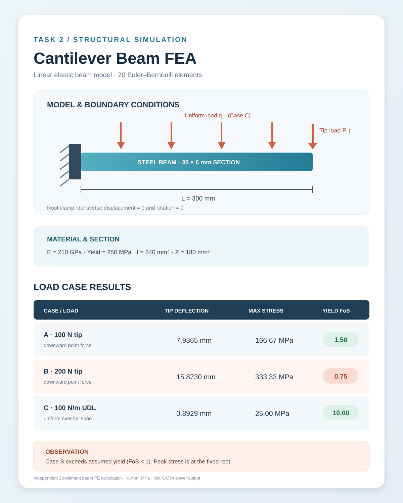

# Task 2 — Structural Simulation (FEA)

A cantilever beam study comparing tip-force and distributed-load cases. This repository contains a written report, calculated result data, reproducible beam-FE source, a CATIA V5 geometry macro, and figures.

## Results at a glance

| Load case | Peak tip deflection | Maximum bending stress | Factor of safety* |
|---|---:|---:|---:|
| 100 N downward tip force | 7.9365 mm | 166.67 MPa | 1.50 |
| 200 N downward tip force | 15.8730 mm | 333.33 MPa | 0.75 |
| 100 N/m downward distributed load | 0.8929 mm | 25.00 MPa | 10.00 |

\*FoS is based on an assumed 250 MPa yield strength.

## Open the submission

- [Structural simulation report](structural_fea_report.html)
- [Result data (CSV)](fea_results.csv)
- [Complete submission package (ZIP)](task2_structural_fea_submission.zip)

## Model and method

The study uses a 300 × 30 × 6 mm rectangular cantilever beam, with steel properties of E = 210 GPa and assumed yield strength = 250 MPa. The calculated results come from an independent, linear Euler–Bernoulli beam finite-element model with 20 elements. The reported stress is nominal bending stress.

The solver is a simplified beam model. It does not include shear deformation, stress concentrations, fatigue, buckling, or self-weight. The numeric results are not presented as output from the CATIA Generative Structural Analysis solver.

## Files

- `fea_beam.js` — Node.js beam finite-element calculation and result generator.
- `fea_results.csv` — result values for each load case.
- `cantilever_beam.CATScript` — CATIA V5 macro to create and save the beam solid.
- `beam_geometry_loads.svg`, `deflection_chart.svg`, `stress_chart.svg` — report figures.
- `structural_fea_report.html` — detailed report with model definition, load cases, results, observations, and figures.

## CATIA V5 geometry

Run `cantilever_beam.CATScript` in CATIA V5 through **Tools → Macro → Macros** to create the editable beam geometry. For a native CATIA structural simulation, use Generative Structural Analysis if it is licensed, apply the boundary conditions and separate loads, mesh and solve, then capture the CATIA result screenshots. The report distinguishes the independent beam-FE calculations from CATIA solver results.
